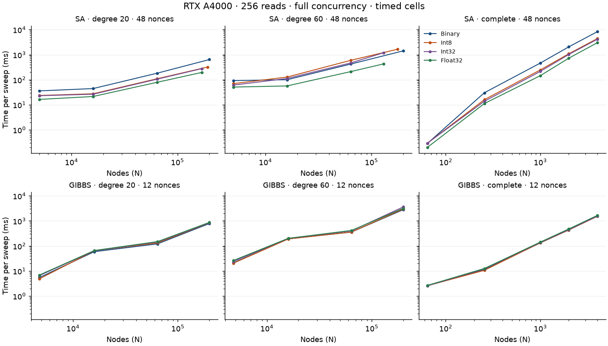
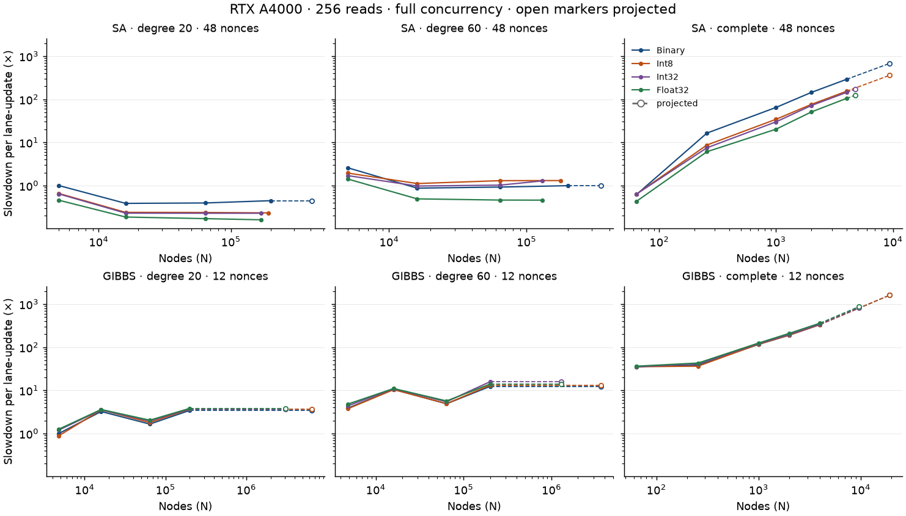

# A4000 capacity and slowdown for `sa` and `gibbs`

The probes use free device memory and the instance count to set node limits.
SA uses 48 instances. Gibbs uses 12 instances, with four SMs per instance.
The tables show both how much fits and how long it runs.

## Test setup

- Physical GPU: 1, NVIDIA RTX A4000, 48 SMs.
- Container: `quip-solver-cuda-ci`, CUDA 12.9.1.
- Grid binaries: `1b8108a309a9d3c4ef543858af3ac4ddf13ebc6c` with the probe calibration edits. No kernel or benchmark code differs.
- Reads: 256 per nonce. Concurrency: full instance count and one nonce.
- Each sweep point uses one warm-up and four measured repeats.
- Sweep pairs: 64/256, or 8/32 when earlier cells predict more than 900 seconds for 64/256.
- The 64/256 and 8/32 pairs use four sweeps per beta rung.
- Some cells larger than the timed range ran with 2/8 or 1/4 sweeps at one sweep per beta rung. Those runs are smoke runs, and the report does not use their timing.
- Each GPU run ends before the next starts. Each run records compute processes on physical GPU 1.

Raw records, commands, generation logs, and scripts are in
`/zfspool/quip-mining/bench-evidence/sa-gibbs-vram-dense/`.
The folder holds `gate.sh`, `grid.sh`, `manifest.json`, `summary.json`, and `summary.md`.

For each repeat, subtract the lower-sweep launch time from the higher-sweep launch time.
Divide by the sweep-count difference, then take the median across the four paired repeats.
This removes fixed launch costs from the sweep estimate.
Per lane-update time divides sweep time by N × reads.
Throughput multiplies N × reads by the nonce count, then divides by sweep time.
Slowdown uses the degree-20 Binary baseline at the same nonce count.
SA uses N = 5,000. Gibbs uses N = 4,800.
The sparse models use circulant graphs. These runs keep the node order.

## Timed range and projections

Timed cells stop where the slowdown curve is clear in the full-spill regime.
SA uses its global-state variant for models larger than 5,000 nodes. Gibbs keeps most spins in the global tail for models much larger than 4,800 nodes.
The timed range is 200,000 nodes for sparse models and 4,000 nodes for complete models.
Larger cells are smoke runs. A smoke run passes when it ends with a result, or runs for one hour with no error.

Each larger probe-limit cell gets a projected slowdown from the last timed cell in its series:

- Sparse models keep the last timed value. At a fixed degree, the work per lane-update does not depend on N.
- Complete models scale the last timed value by N. Each lane-update reads N - 1 couplers.

Every projected value has the label projected in the tables, the plots, and `src/slowdown_a4000.rs`.

## Runtime capacity grids

Free device memory can change between runs. Each probe snapshot fixes the limit cells for its kernel.
Each precision tier covers both fields and couplings.
Using one nonce keeps the same node limit.

All 279 preflight records show no compute processes on GPU 1.

### `sa`

The probe reports 16,621,961,216 free bytes and 13,297,568,972 usable bytes.
Each of 48 instances has a budget of 277,032,686 bytes.

| Connectivity | Precision | Nodes | Couplers | Tier | Bytes per instance | Slowdown |
|---|---|---:|---:|---|---:|---:|
| degree 20 | Binary | 410,747 | 4,107,470 | global | 275,614,821 | 0.4464× (projected) |
| degree 20 | Int8 | 191,788 | 1,917,880 | global | 275,986,420 | 0.2329× |
| degree 20 | Int32 | 169,546 | 1,695,460 | global | 276,024,568 | 0.2282× |
| degree 20 | Float32 | 169,553 | 1,695,530 | global | 276,036,060 | 0.1609× |
| degree 60 | Binary | 347,112 | 10,413,360 | global | 274,568,696 | 0.9939× (projected) |
| degree 60 | Int8 | 176,665 | 5,299,950 | global | 275,424,511 | 1.3056× |
| degree 60 | Int32 | 130,765 | 3,922,950 | global | 275,656,012 | 1.2839× |
| degree 60 | Float32 | 130,771 | 3,923,130 | global | 275,668,852 | 0.4591× |
| complete | Binary | 9,370 | 43,893,765 | dense | 276,315,610 | 676.0332× (projected) |
| complete | Int8 | 9,370 | 43,893,765 | dense | 276,315,610 | 358.2948× (projected) |
| complete | Int32 | 4,741 | 11,236,170 | dense | 276,308,872 | 170.0646× (projected) |
| complete | Float32 | 4,741 | 11,236,170 | dense | 276,308,872 | 123.6501× (projected) |

### `gibbs`

The probe reports 16,621,961,216 free bytes and 13,297,568,972 usable bytes.
Each of 12 instances has a budget of 1,108,130,747 bytes.

| Connectivity | Precision | Nodes | Couplers | Tier | Bytes per instance | Slowdown |
|---|---|---:|---:|---|---:|---:|
| degree 20 | Binary | 6,491,600 | 64,916,000 | spill | 1,057,728,632 | 3.4278× (projected) |
| degree 20 | Int8 | 6,491,600 | 64,916,000 | spill | 1,057,728,632 | 3.6443× (projected) |
| degree 20 | Int32 | 3,077,188 | 30,771,880 | spill | 1,082,768,392 | 3.6973× (projected) |
| degree 20 | Float32 | 3,077,188 | 30,771,880 | spill | 1,082,768,392 | 3.8183× (projected) |
| degree 60 | Binary | 3,641,281 | 109,238,430 | spill | 1,030,081,347 | 12.3145× (projected) |
| degree 60 | Int8 | 3,641,281 | 109,238,430 | spill | 1,030,081,347 | 13.0756× (projected) |
| degree 60 | Int32 | 1,296,797 | 38,903,910 | spill | 1,078,533,544 | 15.8278× (projected) |
| degree 60 | Float32 | 1,296,797 | 38,903,910 | spill | 1,078,533,544 | 13.9336× (projected) |
| complete | Binary | 19,177 | 183,869,076 | dense | 1,105,327,703 | 1598.2570× (projected) |
| complete | Int8 | 19,177 | 183,869,076 | dense | 1,105,327,703 | 1600.3476× (projected) |
| complete | Int32 | 9,592 | 45,998,436 | dense | 1,105,193,345 | 821.1391× (projected) |
| complete | Float32 | 9,592 | 45,998,436 | dense | 1,105,193,345 | 864.9393× (projected) |

## Timing tables

Sweep time is in milliseconds. Throughput is in billions of lane-updates per second.
Each slowdown uses the baseline with the same kernel and nonce count.
The tables hold the timed range only, and the Smoke runs section lists the larger cells. Failed cells appear in the final section.

### `sa`

| Connectivity | Precision | N | Nonces | Sweeps | Sweep ms | G lane-updates/s | Slowdown |
|---|---|---:|---:|---|---:|---:|---:|
| degree 20 | binary | 5,000 | 48 | 64/256 | 35.813684 | 1.71555 | 1.0000× |
| degree 20 | binary | 16,000 | 48 | 64/256 | 44.291067 | 4.43900 | 0.3865× |
| degree 20 | binary | 64,000 | 48 | 64/256 | 181.080416 | 4.34300 | 0.3950× |
| degree 20 | binary | 200,000 | 48 | 8/32 | 639.438334 | 3.84337 | 0.4464× |
| degree 20 | binary | 5,000 | 1 | 64/256 | 16.431101 | 0.07790 | 1.0000× |
| degree 20 | binary | 16,000 | 1 | 64/256 | 42.141366 | 0.09720 | 0.8015× |
| degree 20 | binary | 64,000 | 1 | 64/256 | 174.413254 | 0.09394 | 0.8293× |
| degree 20 | binary | 200,000 | 1 | 8/32 | 600.437449 | 0.08527 | 0.9136× |
| degree 20 | int8 | 5,000 | 48 | 64/256 | 23.484748 | 2.61617 | 0.6557× |
| degree 20 | int8 | 16,000 | 48 | 64/256 | 27.440793 | 7.16481 | 0.2394× |
| degree 20 | int8 | 64,000 | 48 | 64/256 | 108.934326 | 7.21932 | 0.2376× |
| degree 20 | int8 | 191,788 | 48 | 64/256 | 319.942612 | 7.36598 | 0.2329× |
| degree 20 | int8 | 5,000 | 1 | 64/256 | 10.478263 | 0.12216 | 0.6377× |
| degree 20 | int8 | 16,000 | 1 | 64/256 | 22.779241 | 0.17981 | 0.4332× |
| degree 20 | int8 | 64,000 | 1 | 64/256 | 94.536643 | 0.17331 | 0.4495× |
| degree 20 | int8 | 191,788 | 1 | 64/256 | 285.172928 | 0.17217 | 0.4525× |
| degree 20 | int32 | 5,000 | 48 | 64/256 | 22.936603 | 2.67869 | 0.6404× |
| degree 20 | int32 | 16,000 | 48 | 64/256 | 26.298709 | 7.47596 | 0.2295× |
| degree 20 | int32 | 64,000 | 48 | 64/256 | 104.649059 | 7.51495 | 0.2283× |
| degree 20 | int32 | 169,546 | 48 | 64/256 | 277.087962 | 7.51884 | 0.2282× |
| degree 20 | int32 | 5,000 | 1 | 64/256 | 8.996207 | 0.14228 | 0.5475× |
| degree 20 | int32 | 16,000 | 1 | 64/256 | 22.756718 | 0.17999 | 0.4328× |
| degree 20 | int32 | 64,000 | 1 | 64/256 | 91.656044 | 0.17876 | 0.4358× |
| degree 20 | int32 | 169,546 | 1 | 64/256 | 242.789622 | 0.17877 | 0.4358× |
| degree 20 | float | 5,000 | 48 | 64/256 | 16.362125 | 3.75501 | 0.4569× |
| degree 20 | float | 16,000 | 48 | 64/256 | 21.364235 | 9.20267 | 0.1864× |
| degree 20 | float | 64,000 | 48 | 64/256 | 78.505390 | 10.01755 | 0.1713× |
| degree 20 | float | 169,553 | 48 | 64/256 | 195.429700 | 10.66096 | 0.1609× |
| degree 20 | float | 5,000 | 1 | 64/256 | 6.909568 | 0.18525 | 0.4205× |
| degree 20 | float | 16,000 | 1 | 64/256 | 19.022512 | 0.21532 | 0.3618× |
| degree 20 | float | 64,000 | 1 | 64/256 | 70.115969 | 0.23367 | 0.3334× |
| degree 20 | float | 169,553 | 1 | 64/256 | 172.230982 | 0.25202 | 0.3091× |
| degree 60 | binary | 5,000 | 48 | 64/256 | 92.540332 | 0.66393 | 2.5839× |
| degree 60 | binary | 16,000 | 48 | 64/256 | 99.853388 | 1.96897 | 0.8713× |
| degree 60 | binary | 64,000 | 48 | 64/256 | 422.836792 | 1.85989 | 0.9224× |
| degree 60 | binary | 200,000 | 48 | 8/32 | 1423.747559 | 1.72615 | 0.9939× |
| degree 60 | binary | 5,000 | 1 | 64/256 | 44.427551 | 0.02881 | 2.7039× |
| degree 60 | binary | 16,000 | 1 | 64/256 | 76.041826 | 0.05387 | 1.4462× |
| degree 60 | binary | 64,000 | 1 | 64/256 | 300.405874 | 0.05454 | 1.4283× |
| degree 60 | binary | 200,000 | 1 | 8/32 | 1382.215719 | 0.03704 | 2.1030× |
| degree 60 | int8 | 5,000 | 48 | 64/256 | 69.745257 | 0.88092 | 1.9474× |
| degree 60 | int8 | 16,000 | 48 | 64/256 | 127.660962 | 1.54008 | 1.1139× |
| degree 60 | int8 | 64,000 | 48 | 8/32 | 595.274089 | 1.32113 | 1.2985× |
| degree 60 | int8 | 176,665 | 48 | 8/32 | 1652.084066 | 1.31401 | 1.3056× |
| degree 60 | int8 | 5,000 | 1 | 64/256 | 28.436540 | 0.04501 | 1.7307× |
| degree 60 | int8 | 16,000 | 1 | 64/256 | 56.635904 | 0.07232 | 1.0771× |
| degree 60 | int8 | 64,000 | 1 | 64/256 | 232.810308 | 0.07037 | 1.1069× |
| degree 60 | int8 | 176,665 | 1 | 8/32 | 683.309143 | 0.06619 | 1.1770× |
| degree 60 | int32 | 5,000 | 48 | 64/256 | 60.966003 | 1.00777 | 1.7023× |
| degree 60 | int32 | 16,000 | 48 | 64/256 | 111.818255 | 1.75828 | 0.9757× |
| degree 60 | int32 | 64,000 | 48 | 64/256 | 468.697021 | 1.67791 | 1.0224× |
| degree 60 | int32 | 130,765 | 48 | 8/32 | 1202.507894 | 1.33624 | 1.2839× |
| degree 60 | int32 | 5,000 | 1 | 64/256 | 23.941796 | 0.05346 | 1.4571× |
| degree 60 | int32 | 16,000 | 1 | 64/256 | 56.396973 | 0.07263 | 1.0726× |
| degree 60 | int32 | 64,000 | 1 | 64/256 | 229.886464 | 0.07127 | 1.0930× |
| degree 60 | int32 | 130,765 | 1 | 64/256 | 449.155629 | 0.07453 | 1.0452× |
| degree 60 | float | 5,000 | 48 | 64/256 | 50.801970 | 1.20940 | 1.4185× |
| degree 60 | float | 16,000 | 48 | 64/256 | 56.360413 | 3.48841 | 0.4918× |
| degree 60 | float | 64,000 | 48 | 64/256 | 211.419469 | 3.71977 | 0.4612× |
| degree 60 | float | 130,771 | 48 | 64/256 | 430.046529 | 3.73661 | 0.4591× |
| degree 60 | float | 5,000 | 1 | 64/256 | 17.985558 | 0.07117 | 1.0946× |
| degree 60 | float | 16,000 | 1 | 64/256 | 38.132446 | 0.10742 | 0.7252× |
| degree 60 | float | 64,000 | 1 | 64/256 | 137.429698 | 0.11922 | 0.6534× |
| degree 60 | float | 130,771 | 1 | 64/256 | 284.154099 | 0.11781 | 0.6612× |
| complete | binary | 64 | 48 | 64/256 | 0.284956 | 2.75983 | 0.6216× |
| complete | binary | 256 | 48 | 64/256 | 30.129839 | 0.10441 | 16.4315× |
| complete | binary | 1,000 | 48 | 64/256 | 462.956848 | 0.02654 | 64.6341× |
| complete | binary | 2,000 | 48 | 8/32 | 2056.994588 | 0.01195 | 143.5900× |
| complete | binary | 4,000 | 48 | 8/32 | 8268.513428 | 0.00594 | 288.5948× |
| complete | binary | 64 | 1 | 64/256 | 0.253771 | 0.06456 | 1.2066× |
| complete | binary | 256 | 1 | 64/256 | 9.534551 | 0.00687 | 11.3335× |
| complete | binary | 1,000 | 1 | 64/256 | 143.589788 | 0.00178 | 43.6945× |
| complete | binary | 2,000 | 1 | 8/32 | 652.602559 | 0.00078 | 99.2938× |
| complete | binary | 4,000 | 1 | 8/32 | 5539.553955 | 0.00018 | 421.4229× |
| complete | int8 | 64 | 48 | 64/256 | 0.291588 | 2.69706 | 0.6361× |
| complete | int8 | 256 | 48 | 64/256 | 15.923478 | 0.19755 | 8.6840× |
| complete | int8 | 1,000 | 48 | 64/256 | 246.069483 | 0.04994 | 34.3541× |
| complete | int8 | 2,000 | 48 | 8/32 | 1085.807393 | 0.02263 | 75.7956× |
| complete | int8 | 4,000 | 48 | 8/32 | 4382.277507 | 0.01122 | 152.9540× |
| complete | int8 | 64 | 1 | 64/256 | 0.178592 | 0.09174 | 0.8492× |
| complete | int8 | 256 | 1 | 64/256 | 5.048844 | 0.01298 | 6.0014× |
| complete | int8 | 1,000 | 1 | 64/256 | 75.526843 | 0.00339 | 22.9829× |
| complete | int8 | 2,000 | 1 | 64/256 | 311.304204 | 0.00164 | 47.3651× |
| complete | int8 | 4,000 | 1 | 8/32 | 2876.709717 | 0.00036 | 218.8464× |
| complete | int32 | 64 | 48 | 64/256 | 0.292085 | 2.69247 | 0.6372× |
| complete | int32 | 256 | 48 | 64/256 | 13.754685 | 0.22870 | 7.5012× |
| complete | int32 | 1,000 | 48 | 64/256 | 214.523791 | 0.05728 | 29.9500× |
| complete | int32 | 2,000 | 48 | 8/32 | 1020.416361 | 0.02408 | 71.2309× |
| complete | int32 | 4,000 | 48 | 8/32 | 4110.956787 | 0.01196 | 143.4841× |
| complete | int32 | 64 | 1 | 64/256 | 0.140523 | 0.11659 | 0.6681× |
| complete | int32 | 256 | 1 | 64/256 | 4.375096 | 0.01498 | 5.2006× |
| complete | int32 | 1,000 | 1 | 64/256 | 75.453946 | 0.00339 | 22.9607× |
| complete | int32 | 2,000 | 1 | 64/256 | 302.018326 | 0.00170 | 45.9522× |
| complete | int32 | 4,000 | 1 | 8/32 | 2774.781494 | 0.00037 | 211.0922× |
| complete | float | 64 | 48 | 64/256 | 0.198220 | 3.96748 | 0.4324× |
| complete | float | 256 | 48 | 64/256 | 11.149643 | 0.28214 | 6.0805× |
| complete | float | 1,000 | 48 | 64/256 | 145.030741 | 0.08473 | 20.2480× |
| complete | float | 2,000 | 48 | 8/32 | 724.754313 | 0.03391 | 50.5920× |
| complete | float | 4,000 | 48 | 8/32 | 2988.983968 | 0.01644 | 104.3241× |
| complete | float | 64 | 1 | 64/256 | 0.124264 | 0.13185 | 0.5908× |
| complete | float | 256 | 1 | 64/256 | 3.698568 | 0.01772 | 4.3964× |
| complete | float | 1,000 | 1 | 64/256 | 52.594143 | 0.00487 | 16.0044× |
| complete | float | 2,000 | 1 | 64/256 | 192.265986 | 0.00266 | 29.2534× |
| complete | float | 4,000 | 1 | 8/32 | 2011.958415 | 0.00051 | 153.0602× |

### `gibbs`

| Connectivity | Precision | N | Nonces | Sweeps | Sweep ms | G lane-updates/s | Slowdown |
|---|---|---:|---:|---|---:|---:|---:|
| degree 20 | binary | 4,800 | 12 | 64/256 | 5.497795 | 2.68209 | 1.0000× |
| degree 20 | binary | 16,000 | 12 | 64/256 | 59.107871 | 0.83156 | 3.2254× |
| degree 20 | binary | 64,000 | 12 | 64/256 | 121.000988 | 1.62485 | 1.6507× |
| degree 20 | binary | 200,000 | 12 | 64/256 | 785.232310 | 0.78244 | 3.4278× |
| degree 20 | binary | 4,800 | 1 | 64/256 | 4.355447 | 0.28213 | 1.0000× |
| degree 20 | binary | 16,000 | 1 | 64/256 | 33.069009 | 0.12386 | 2.2778× |
| degree 20 | binary | 64,000 | 1 | 64/256 | 95.880447 | 0.17088 | 1.6510× |
| degree 20 | binary | 200,000 | 1 | 64/256 | 640.133464 | 0.07998 | 3.5274× |
| degree 20 | int8 | 4,800 | 12 | 64/256 | 4.876751 | 3.02365 | 0.8870× |
| degree 20 | int8 | 16,000 | 12 | 64/256 | 64.472672 | 0.76237 | 3.5181× |
| degree 20 | int8 | 64,000 | 12 | 64/256 | 132.074389 | 1.48862 | 1.8017× |
| degree 20 | int8 | 200,000 | 12 | 64/256 | 834.823792 | 0.73596 | 3.6443× |
| degree 20 | int8 | 4,800 | 1 | 64/256 | 4.169994 | 0.29468 | 0.9574× |
| degree 20 | int8 | 16,000 | 1 | 64/256 | 34.378634 | 0.11914 | 2.3680× |
| degree 20 | int8 | 64,000 | 1 | 64/256 | 96.974417 | 0.16895 | 1.6699× |
| degree 20 | int8 | 200,000 | 1 | 64/256 | 644.113057 | 0.07949 | 3.5493× |
| degree 20 | int32 | 4,800 | 12 | 64/256 | 6.591677 | 2.23700 | 1.1990× |
| degree 20 | int32 | 16,000 | 12 | 64/256 | 64.388643 | 0.76336 | 3.5135× |
| degree 20 | int32 | 64,000 | 12 | 64/256 | 143.389852 | 1.37114 | 1.9561× |
| degree 20 | int32 | 200,000 | 12 | 64/256 | 846.958211 | 0.72542 | 3.6973× |
| degree 20 | int32 | 4,800 | 1 | 64/256 | 4.462780 | 0.27534 | 1.0246× |
| degree 20 | int32 | 16,000 | 1 | 64/256 | 36.212374 | 0.11311 | 2.4943× |
| degree 20 | int32 | 64,000 | 1 | 64/256 | 100.856597 | 0.16245 | 1.7367× |
| degree 20 | int32 | 200,000 | 1 | 64/256 | 640.668803 | 0.07992 | 3.5303× |
| degree 20 | float | 4,800 | 12 | 64/256 | 6.922325 | 2.13015 | 1.2591× |
| degree 20 | float | 16,000 | 12 | 64/256 | 65.859039 | 0.74632 | 3.5938× |
| degree 20 | float | 64,000 | 12 | 64/256 | 148.860469 | 1.32075 | 2.0307× |
| degree 20 | float | 200,000 | 12 | 64/256 | 874.675883 | 0.70243 | 3.8183× |
| degree 20 | float | 4,800 | 1 | 64/256 | 4.607019 | 0.26672 | 1.0578× |
| degree 20 | float | 16,000 | 1 | 64/256 | 34.747630 | 0.11788 | 2.3934× |
| degree 20 | float | 64,000 | 1 | 64/256 | 105.292745 | 0.15560 | 1.8131× |
| degree 20 | float | 200,000 | 1 | 64/256 | 670.847280 | 0.07632 | 3.6966× |
| degree 60 | binary | 4,800 | 12 | 64/256 | 21.173981 | 0.69640 | 3.8514× |
| degree 60 | binary | 16,000 | 12 | 64/256 | 192.520414 | 0.25531 | 10.5053× |
| degree 60 | binary | 64,000 | 12 | 8/32 | 357.520569 | 0.54992 | 4.8772× |
| degree 60 | binary | 200,000 | 12 | 8/32 | 2820.936808 | 0.21780 | 12.3145× |
| degree 60 | binary | 4,800 | 1 | 64/256 | 13.805791 | 0.08901 | 3.1698× |
| degree 60 | binary | 16,000 | 1 | 64/256 | 164.052882 | 0.02497 | 11.2998× |
| degree 60 | binary | 64,000 | 1 | 8/32 | 285.496480 | 0.05739 | 4.9162× |
| degree 60 | binary | 200,000 | 1 | 8/32 | 1973.534871 | 0.02594 | 10.8749× |
| degree 60 | int8 | 4,800 | 12 | 64/256 | 20.511592 | 0.71889 | 3.7309× |
| degree 60 | int8 | 16,000 | 12 | 64/256 | 190.038981 | 0.25864 | 10.3699× |
| degree 60 | int8 | 64,000 | 12 | 8/32 | 359.585180 | 0.54676 | 4.9054× |
| degree 60 | int8 | 200,000 | 12 | 8/32 | 2995.287638 | 0.20512 | 13.0756× |
| degree 60 | int8 | 4,800 | 1 | 64/256 | 13.895509 | 0.08843 | 3.1904× |
| degree 60 | int8 | 16,000 | 1 | 64/256 | 164.178396 | 0.02495 | 11.3085× |
| degree 60 | int8 | 64,000 | 1 | 8/32 | 289.290273 | 0.05664 | 4.9815× |
| degree 60 | int8 | 200,000 | 1 | 8/32 | 1976.587687 | 0.02590 | 10.8917× |
| degree 60 | int32 | 4,800 | 12 | 64/256 | 23.980204 | 0.61491 | 4.3618× |
| degree 60 | int32 | 16,000 | 12 | 64/256 | 199.684644 | 0.24615 | 10.8963× |
| degree 60 | int32 | 64,000 | 12 | 8/32 | 399.051504 | 0.49269 | 5.4438× |
| degree 60 | int32 | 200,000 | 12 | 8/32 | 3625.759562 | 0.16945 | 15.8278× |
| degree 60 | int32 | 4,800 | 1 | 64/256 | 14.148421 | 0.08685 | 3.2484× |
| degree 60 | int32 | 16,000 | 1 | 64/256 | 164.286069 | 0.02493 | 11.3159× |
| degree 60 | int32 | 64,000 | 1 | 8/32 | 306.641230 | 0.05343 | 5.2803× |
| degree 60 | int32 | 200,000 | 1 | 8/32 | 2000.955933 | 0.02559 | 11.0259× |
| degree 60 | float | 4,800 | 12 | 64/256 | 26.281795 | 0.56106 | 4.7804× |
| degree 60 | float | 16,000 | 12 | 8/32 | 201.672900 | 0.24372 | 11.0048× |
| degree 60 | float | 64,000 | 12 | 8/32 | 415.801290 | 0.47284 | 5.6723× |
| degree 60 | float | 200,000 | 12 | 8/32 | 3191.826904 | 0.19249 | 13.9336× |
| degree 60 | float | 4,800 | 1 | 64/256 | 14.633248 | 0.08397 | 3.3598× |
| degree 60 | float | 16,000 | 1 | 64/256 | 169.963450 | 0.02410 | 11.7070× |
| degree 60 | float | 64,000 | 1 | 8/32 | 315.331406 | 0.05196 | 5.4299× |
| degree 60 | float | 200,000 | 1 | 8/32 | 2040.884196 | 0.02509 | 11.2460× |
| complete | binary | 64 | 12 | 64/256 | 2.588320 | 0.07596 | 35.3094× |
| complete | binary | 256 | 12 | 64/256 | 11.189041 | 0.07029 | 38.1598× |
| complete | binary | 1,000 | 12 | 64/256 | 132.589101 | 0.02317 | 115.7605× |
| complete | binary | 2,000 | 12 | 64/256 | 435.714462 | 0.01410 | 190.2062× |
| complete | binary | 4,000 | 12 | 8/32 | 1527.331238 | 0.00805 | 333.3696× |
| complete | binary | 64 | 1 | 64/256 | 2.526528 | 0.00648 | 43.5063× |
| complete | binary | 256 | 1 | 64/256 | 10.369216 | 0.00632 | 44.6390× |
| complete | binary | 1,000 | 1 | 64/256 | 81.794095 | 0.00313 | 90.1427× |
| complete | binary | 2,000 | 1 | 64/256 | 257.268951 | 0.00199 | 141.7640× |
| complete | binary | 4,000 | 1 | 8/32 | 1484.435303 | 0.00069 | 408.9872× |
| complete | int8 | 64 | 12 | 64/256 | 2.581835 | 0.07615 | 35.2210× |
| complete | int8 | 256 | 12 | 64/256 | 10.632496 | 0.07396 | 36.2617× |
| complete | int8 | 1,000 | 12 | 64/256 | 134.406471 | 0.02286 | 117.3472× |
| complete | int8 | 2,000 | 12 | 64/256 | 435.814931 | 0.01410 | 190.2501× |
| complete | int8 | 4,000 | 12 | 8/32 | 1529.329061 | 0.00803 | 333.8056× |
| complete | int8 | 64 | 1 | 64/256 | 2.567251 | 0.00638 | 44.2076× |
| complete | int8 | 256 | 1 | 64/256 | 10.558637 | 0.00621 | 45.4544× |
| complete | int8 | 1,000 | 1 | 64/256 | 82.478690 | 0.00310 | 90.8971× |
| complete | int8 | 2,000 | 1 | 64/256 | 258.656240 | 0.00198 | 142.5284× |
| complete | int8 | 4,000 | 1 | 8/32 | 1481.296590 | 0.00069 | 408.1225× |
| complete | int32 | 64 | 12 | 64/256 | 2.574459 | 0.07637 | 35.1203× |
| complete | int32 | 256 | 12 | 64/256 | 12.075400 | 0.06513 | 41.1826× |
| complete | int32 | 1,000 | 12 | 64/256 | 138.647242 | 0.02216 | 121.0498× |
| complete | int32 | 2,000 | 12 | 8/32 | 451.203257 | 0.01362 | 196.9677× |
| complete | int32 | 4,000 | 12 | 8/32 | 1568.826355 | 0.00783 | 342.4267× |
| complete | int32 | 64 | 1 | 64/256 | 2.593779 | 0.00632 | 44.6644× |
| complete | int32 | 256 | 1 | 64/256 | 12.003857 | 0.00546 | 51.6761× |
| complete | int32 | 1,000 | 1 | 64/256 | 87.369921 | 0.00293 | 96.2876× |
| complete | int32 | 2,000 | 1 | 64/256 | 450.192027 | 0.00114 | 248.0712× |
| complete | int32 | 4,000 | 1 | 8/32 | 1578.442952 | 0.00065 | 434.8879× |
| complete | float | 64 | 12 | 64/256 | 2.657272 | 0.07399 | 36.2501× |
| complete | float | 256 | 12 | 64/256 | 12.561307 | 0.06261 | 42.8398× |
| complete | float | 1,000 | 12 | 64/256 | 142.549367 | 0.02155 | 124.4566× |
| complete | float | 2,000 | 12 | 8/32 | 477.867757 | 0.01286 | 208.6077× |
| complete | float | 4,000 | 12 | 8/32 | 1652.508667 | 0.00744 | 360.6919× |
| complete | float | 64 | 1 | 64/256 | 2.681346 | 0.00611 | 46.1723× |
| complete | float | 256 | 1 | 64/256 | 12.425445 | 0.00527 | 53.4910× |
| complete | float | 1,000 | 1 | 64/256 | 91.191933 | 0.00281 | 100.4997× |
| complete | float | 2,000 | 1 | 64/256 | 457.305364 | 0.00112 | 251.9908× |
| complete | float | 4,000 | 1 | 8/32 | 1604.728841 | 0.00064 | 442.1302× |

## Observations

SA keeps spin state in a fixed local frame through 5,000 nodes and in global memory for larger models.
Gibbs uses its spill instantiation for models larger than 4,800 nodes. Both baselines run the mining-size kernels.
At 48 nonces, SA degree-20 Binary cells larger than 5,000 nodes take 0.39× to 0.45× the baseline time per lane-update.
At this concurrency, the mining-size SA kernel is slower per lane-update than the global-memory SA kernel.
At 12 nonces, Gibbs degree-20 Binary cells larger than 4,800 nodes take 1.65× to 3.43× the baseline time per lane-update.

## Full-concurrency curves

The plots use logarithmic axes. Solid lines connect timed points.
Dashed lines with open markers lead to projected values at the probe limit. The sweep-time plot shows timed points only.
Each kernel uses its full instance count at 256 reads.





## Smoke runs

A smoke run passes when it ends with a result, or when it runs for one hour with no error.
Each grid cell larger than the timed range ended with a result. The slowdown column shows the projection, not a measurement.

| Cell | Sweeps | Wall seconds | Result | Projected slowdown |
|---|---|---:|---|---:|
| `sa-degree-20-binary-m48-n410747` | 8/32 | 357.7 | completed with a result | 0.4464× |
| `gibbs-degree-20-binary-m12-n6491600` | 2/8 | 3207.8 | completed with a result | 3.4278× |
| `sa-degree-20-binary-m1-n410747` | 8/32 | 322.3 | completed with a result | not projected |
| `gibbs-degree-20-binary-m1-n6491600` | 2/8 | 2761.0 | completed with a result | not projected |
| `gibbs-degree-20-int8-m12-n6491600` | 2/8 | 3538.0 | completed with a result | 3.6443× |
| `gibbs-degree-20-int8-m1-n6491600` | 2/8 | 2791.3 | completed with a result | not projected |
| `gibbs-degree-20-int32-m12-n3077188` | 2/8 | 1632.8 | completed with a result | 3.6973× |
| `gibbs-degree-20-int32-m1-n3077188` | 2/8 | 1334.4 | completed with a result | not projected |
| `gibbs-degree-20-float-m12-n3077188` | 2/8 | 1256.9 | completed with a result | 3.8183× |
| `gibbs-degree-20-float-m1-n3077188` | 2/8 | 972.5 | completed with a result | not projected |
| `sa-degree-60-binary-m48-n347112` | 8/32 | 676.7 | completed with a result | 0.9939× |
| `gibbs-degree-60-binary-m12-n3641281` | 1/4 | 3653.0 | completed with a result | 12.3145× |
| `sa-degree-60-binary-m1-n347112` | 8/32 | 641.4 | completed with a result | not projected |
| `gibbs-degree-60-binary-m1-n3641281` | 1/4 | 2920.4 | completed with a result | not projected |
| `gibbs-degree-60-int8-m12-n3641281` | 1/4 | 3814.4 | completed with a result | 13.0756× |
| `gibbs-degree-60-int8-m1-n3641281` | 1/4 | 3011.8 | completed with a result | not projected |
| `gibbs-degree-60-int32-m12-n1296797` | 2/8 | 2563.4 | completed with a result | 15.8278× |
| `gibbs-degree-60-int32-m1-n1296797` | 2/8 | 1466.8 | completed with a result | not projected |
| `gibbs-degree-60-float-m12-n1296797` | 2/8 | 1547.0 | completed with a result | 13.9336× |
| `gibbs-degree-60-float-m1-n1296797` | 2/8 | 967.3 | completed with a result | not projected |
| `sa-complete-binary-m48-n9370` | 1/4 | 1499.2 | completed with a result | 676.0332× |
| `gibbs-complete-binary-m12-n19177` | 1/4 | 3385.9 | completed with a result | 1598.2570× |
| `sa-complete-binary-m1-n9370` | 2/8 | 1852.3 | completed with a result | not projected |
| `gibbs-complete-binary-m1-n19177` | 1/4 | 3263.6 | completed with a result | not projected |
| `sa-complete-int8-m48-n9370` | 2/8 | 2950.9 | completed with a result | 358.2948× |
| `gibbs-complete-int8-m12-n19177` | 1/4 | 3495.0 | completed with a result | 1600.3476× |
| `sa-complete-int8-m1-n9370` | 2/8 | 2023.6 | completed with a result | not projected |
| `gibbs-complete-int8-m1-n19177` | 1/4 | 3296.7 | completed with a result | not projected |
| `sa-complete-int32-m48-n4741` | 8/32 | 1816.2 | completed with a result | 170.0646× |
| `gibbs-complete-int32-m12-n9592` | 2/8 | 1124.9 | completed with a result | 821.1391× |
| `sa-complete-int32-m1-n4741` | 8/32 | 1216.2 | completed with a result | not projected |
| `gibbs-complete-int32-m1-n9592` | 2/8 | 1167.2 | completed with a result | not projected |
| `sa-complete-float-m48-n4741` | 8/32 | 1505.6 | completed with a result | 123.6501× |
| `gibbs-complete-float-m12-n9592` | 2/8 | 607.1 | completed with a result | 864.9393× |
| `sa-complete-float-m1-n4741` | 8/32 | 996.5 | completed with a result | not projected |
| `gibbs-complete-float-m1-n9592` | 2/8 | 560.1 | completed with a result | not projected |
| `sa-family-b-float-m48-n4741` | 8/32 | 1042.0 | completed with a result | not projected |
| `gibbs-family-b-float-m12-n9592` | 2/8 | 610.2 | completed with a result | not projected |
| `sa-family-b-float-m1-n4741` | 8/32 | 679.9 | completed with a result | not projected |
| `gibbs-family-b-float-m1-n9592` | 2/8 | 560.9 | completed with a result | not projected |

Projections exist only for full-concurrency cells at the probe limit.


The next runs use the current build, which has no launch time limit by default.
Each run has a one-hour cap that the driver script sets with `timeout 3600` inside the container.
Exit code 124 means the run reached the cap with no error.
The longest launch that completed in these runs took 864 seconds, past the old 600-second limit.
Runs that end in `-s8-32` use the grid sweep pair 8/32 with one warm-up and four repeats.
The run that ends in `-s256` uses 256 sweeps at one sweep per beta rung, with one repeat and no warm-up.

| Cell | Start | End | Exit code | Result |
|---|---|---|---:|---|
| `gibbs-degree-20-binary-m12-n6491600-s256` | 2026-10-30T17:02:23Z | 2026-10-30T18:02:24Z | 124 | ran 1 h, no error |
| `gibbs-degree-20-binary-m12-n6491600-s8-32` | 2026-11-03T03:21:59Z | 2026-11-03T04:22:01Z | 124 | ran 1 h, no error |
| `sa-complete-binary-m1-n9370-s8-32` | 2026-11-03T00:21:53Z | 2026-11-03T01:21:58Z | 124 | ran 1 h, no error |
| `sa-complete-binary-m48-n9370-s8-32` | 2026-11-02T23:13:19Z | 2026-11-03T00:21:53Z | 124 | ran 1 h, no error |
| `sa-complete-int8-m1-n9370-s8-32` | 2026-11-03T02:21:59Z | 2026-11-03T03:21:59Z | 124 | ran 1 h, no error |
| `sa-complete-int8-m48-n9370-s8-32` | 2026-11-03T01:21:58Z | 2026-11-03T02:21:59Z | 124 | ran 1 h, no error |

## Projection check against smoke runs

Each smoke run at a full-concurrency probe limit also gives a slowdown from its few sweeps, so its timing is noisier than a timed cell.
The table compares that value with the projection. The calibration uses only the projection.

| Cell | Sweeps | Smoke-run slowdown | Projected slowdown | Projection error |
|---|---|---:|---:|---:|
| `sa-degree-20-binary-m48-n410747` | 8/32 | 0.4548× | 0.4464× | -1.9% |
| `gibbs-degree-20-binary-m12-n6491600` | 2/8 | 4.1576× | 3.4278× | -17.6% |
| `gibbs-degree-20-int8-m12-n6491600` | 2/8 | 4.9561× | 3.6443× | -26.5% |
| `gibbs-degree-20-int32-m12-n3077188` | 2/8 | 4.8424× | 3.6973× | -23.6% |
| `gibbs-degree-20-float-m12-n3077188` | 2/8 | 4.8829× | 3.8183× | -21.8% |
| `sa-degree-60-binary-m48-n347112` | 8/32 | 1.0023× | 0.9939× | -0.8% |
| `gibbs-degree-60-binary-m12-n3641281` | 1/4 | 17.2960× | 12.3145× | -28.8% |
| `gibbs-degree-60-int8-m12-n3641281` | 1/4 | 17.9549× | 13.0756× | -27.2% |
| `gibbs-degree-60-int32-m12-n1296797` | 2/8 | 18.1866× | 15.8278× | -13.0% |
| `gibbs-degree-60-float-m12-n1296797` | 2/8 | 16.1180× | 13.9336× | -13.6% |
| `sa-complete-binary-m48-n9370` | 1/4 | 677.6269× | 676.0332× | -0.2% |
| `gibbs-complete-binary-m12-n19177` | 1/4 | 1398.0027× | 1598.2570× | +14.3% |
| `sa-complete-int8-m48-n9370` | 2/8 | 568.5705× | 358.2948× | -37.0% |
| `gibbs-complete-int8-m12-n19177` | 1/4 | 1398.2126× | 1600.3476× | +14.5% |
| `sa-complete-int32-m48-n4741` | 8/32 | 172.1529× | 170.0646× | -1.2% |
| `gibbs-complete-int32-m12-n9592` | 2/8 | 764.4557× | 821.1391× | +7.4% |
| `sa-complete-float-m48-n4741` | 8/32 | 124.5328× | 123.6501× | -0.7% |
| `gibbs-complete-float-m12-n9592` | 2/8 | 798.4681× | 864.9393× | +8.3% |

## Grid wall time

The first grid preflight timestamp is 2026-10-28T23:51:11Z. The last is 2026-10-30T16:45:53Z.
The grid ran in two passes. The second pass repeated the cells listed under Retried cells.
The actual seconds in the next table come from the grid runner clock for each cell.

## Large-model viability

The first synthetic cell of each series has no prior timing.
Later estimates use the previous cell in that series. For sparse models, the estimate grows with N. For complete models, it grows with N².

For a reduced pair, multiply the wall time by 320 and divide by the sum of the pair before you compare it with a 64/256 estimate.
Family B uses the complete Float32 cell at the same size as its estimate.
The table lists reduced runs, probe-limit cells, and runs that exceed 900 seconds.

| Cell | Sweeps | Estimated full seconds | Actual seconds | Result |
|---|---|---:|---:|---|
| `sa-degree-20-binary-m48-n200000` | 8/32 | 990.2 | 173.6 | passed |
| `sa-degree-20-binary-m48-n410747` | 8/32 | 2853.0 | 357.7 | passed |
| `gibbs-degree-20-binary-m12-n200000` | 64/256 | 650.6 | 1317.9 | passed |
| `gibbs-degree-20-binary-m12-n6491600` | 2/8 | 42775.5 | 3207.8 | passed |
| `sa-degree-20-binary-m1-n200000` | 8/32 | 947.9 | 159.6 | passed |
| `gibbs-degree-20-binary-m1-n200000` | 64/256 | 516.0 | 1082.0 | passed |
| `sa-degree-20-binary-m1-n410747` | 8/32 | 2621.6 | 322.3 | passed |
| `gibbs-degree-20-binary-m1-n6491600` | 2/8 | 35119.1 | 2761.0 | passed |
| `sa-degree-20-int8-m48-n191788` | 64/256 | 609.2 | 584.1 | passed |
| `gibbs-degree-20-int8-m12-n200000` | 64/256 | 709.4 | 1401.3 | passed |
| `gibbs-degree-20-int8-m12-n6491600` | 2/8 | 45483.8 | 3538.0 | passed |
| `sa-degree-20-int8-m1-n191788` | 64/256 | 511.0 | 513.8 | passed |
| `gibbs-degree-20-int8-m1-n200000` | 64/256 | 531.7 | 1089.2 | passed |
| `gibbs-degree-20-int8-m1-n6491600` | 2/8 | 35353.3 | 2791.3 | passed |
| `sa-degree-20-int32-m48-n169546` | 64/256 | 514.4 | 507.2 | passed |
| `gibbs-degree-20-int32-m12-n200000` | 64/256 | 756.0 | 1423.7 | passed |
| `gibbs-degree-20-int32-m12-n3077188` | 2/8 | 21904.7 | 1632.8 | passed |
| `sa-degree-20-int32-m1-n169546` | 64/256 | 444.8 | 440.1 | passed |
| `gibbs-degree-20-int32-m1-n200000` | 64/256 | 552.8 | 1082.6 | passed |
| `gibbs-degree-20-int32-m1-n3077188` | 2/8 | 16656.3 | 1334.4 | passed |
| `sa-degree-20-float-m48-n169553` | 64/256 | 381.3 | 356.9 | passed |
| `gibbs-degree-20-float-m12-n200000` | 64/256 | 753.5 | 1451.2 | passed |
| `gibbs-degree-20-float-m12-n3077188` | 2/8 | 22327.6 | 1256.9 | passed |
| `sa-degree-20-float-m1-n169553` | 64/256 | 337.2 | 310.2 | passed |
| `gibbs-degree-20-float-m1-n200000` | 64/256 | 541.6 | 1105.0 | passed |
| `gibbs-degree-20-float-m1-n3077188` | 2/8 | 17001.1 | 972.5 | passed |
| `sa-degree-60-binary-m48-n200000` | 8/32 | 2208.1 | 385.0 | passed |
| `sa-degree-60-binary-m48-n347112` | 8/32 | 5345.1 | 676.7 | passed |
| `gibbs-degree-60-binary-m12-n64000` | 8/32 | 1272.0 | 103.3 | passed |
| `gibbs-degree-60-binary-m12-n200000` | 8/32 | 2582.0 | 674.2 | passed |
| `gibbs-degree-60-binary-m12-n3641281` | 1/4 | 98197.3 | 3653.0 | passed |
| `gibbs-degree-60-binary-m1-n64000` | 8/32 | 1068.8 | 89.3 | passed |
| `sa-degree-60-binary-m1-n200000` | 8/32 | 1837.9 | 370.5 | passed |
| `gibbs-degree-60-binary-m1-n200000` | 8/32 | 2233.3 | 499.4 | passed |
| `sa-degree-60-binary-m1-n347112` | 8/32 | 5144.7 | 641.4 | passed |
| `gibbs-degree-60-binary-m1-n3641281` | 1/4 | 72740.2 | 2920.4 | passed |
| `sa-degree-60-int8-m48-n64000` | 8/32 | 903.0 | 193.6 | passed |
| `sa-degree-60-int8-m48-n176665` | 8/32 | 4275.5 | 540.4 | passed |
| `gibbs-degree-60-int8-m12-n64000` | 8/32 | 1259.2 | 104.3 | passed |
| `gibbs-degree-60-int8-m12-n200000` | 8/32 | 2606.6 | 700.9 | passed |
| `gibbs-degree-60-int8-m12-n3641281` | 1/4 | 102080.9 | 3814.4 | passed |
| `gibbs-degree-60-int8-m1-n64000` | 8/32 | 1070.8 | 90.8 | passed |
| `sa-degree-60-int8-m1-n176665` | 8/32 | 1166.0 | 264.0 | passed |
| `gibbs-degree-60-int8-m1-n200000` | 8/32 | 2268.8 | 501.0 | passed |
| `gibbs-degree-60-int8-m1-n3641281` | 1/4 | 72965.4 | 3011.8 | passed |
| `sa-degree-60-int32-m48-n130765` | 8/32 | 1762.5 | 394.0 | passed |
| `gibbs-degree-60-int32-m12-n64000` | 8/32 | 1328.7 | 113.3 | passed |
| `gibbs-degree-60-int32-m12-n200000` | 8/32 | 2831.8 | 837.2 | passed |
| `gibbs-degree-60-int32-m12-n1296797` | 2/8 | 43428.4 | 2563.4 | passed |
| `gibbs-degree-60-int32-m1-n64000` | 8/32 | 1099.5 | 95.6 | passed |
| `sa-degree-60-int32-m1-n130765` | 64/256 | 852.9 | 848.5 | passed |
| `gibbs-degree-60-int32-m1-n200000` | 8/32 | 2391.2 | 510.6 | passed |
| `gibbs-degree-60-int32-m1-n1296797` | 2/8 | 26484.1 | 1466.8 | passed |
| `sa-degree-60-float-m48-n130771` | 64/256 | 833.1 | 824.3 | passed |
| `gibbs-degree-60-float-m12-n16000` | 8/32 | 1063.1 | 407.2 | passed |
| `gibbs-degree-60-float-m12-n64000` | 8/32 | 13029.4 | 103.8 | passed |
| `gibbs-degree-60-float-m12-n200000` | 8/32 | 2595.9 | 737.0 | passed |
| `gibbs-degree-60-float-m12-n1296797` | 2/8 | 38229.4 | 1547.0 | passed |
| `gibbs-degree-60-float-m1-n64000` | 8/32 | 1098.5 | 74.1 | passed |
| `sa-degree-60-float-m1-n130771` | 64/256 | 544.3 | 551.0 | passed |
| `gibbs-degree-60-float-m1-n200000` | 8/32 | 1853.1 | 451.3 | passed |
| `gibbs-degree-60-float-m1-n1296797` | 2/8 | 23410.4 | 967.3 | passed |
| `sa-complete-binary-m48-n2000` | 8/32 | 2978.2 | 369.9 | passed |
| `sa-complete-binary-m48-n4000` | 8/32 | 11837.4 | 1475.3 | passed |
| `sa-complete-binary-m48-n9370` | 1/4 | 64761.6 | 1499.2 | passed |
| `gibbs-complete-binary-m12-n4000` | 8/32 | 2909.1 | 417.8 | passed |
| `gibbs-complete-binary-m12-n19177` | 1/4 | 76827.8 | 3385.9 | passed |
| `sa-complete-binary-m1-n2000` | 8/32 | 951.3 | 137.6 | passed |
| `sa-complete-binary-m1-n4000` | 8/32 | 4402.1 | 1004.6 | passed |
| `gibbs-complete-binary-m1-n4000` | 8/32 | 1761.5 | 404.3 | passed |
| `sa-complete-binary-m1-n9370` | 2/8 | 44102.1 | 1852.3 | passed |
| `gibbs-complete-binary-m1-n19177` | 1/4 | 74351.3 | 3263.6 | passed |
| `sa-complete-int8-m48-n2000` | 8/32 | 1711.9 | 332.4 | passed |
| `sa-complete-int8-m48-n4000` | 8/32 | 10638.2 | 1311.5 | passed |
| `sa-complete-int8-m48-n9370` | 2/8 | 57574.4 | 2950.9 | passed |
| `gibbs-complete-int8-m12-n4000` | 8/32 | 2916.7 | 418.8 | passed |
| `gibbs-complete-int8-m12-n19177` | 1/4 | 77011.1 | 3495.0 | passed |
| `sa-complete-int8-m1-n4000` | 8/32 | 2231.3 | 875.4 | passed |
| `gibbs-complete-int8-m1-n4000` | 8/32 | 1772.4 | 404.7 | passed |
| `sa-complete-int8-m1-n9370` | 2/8 | 38427.8 | 2023.6 | passed |
| `gibbs-complete-int8-m1-n19177` | 1/4 | 74418.1 | 3296.7 | passed |
| `sa-complete-int32-m48-n2000` | 8/32 | 1512.0 | 319.0 | passed |
| `sa-complete-int32-m48-n4000` | 8/32 | 10209.1 | 1282.9 | passed |
| `sa-complete-int32-m48-n4741` | 8/32 | 14417.4 | 1816.2 | passed |
| `gibbs-complete-int32-m12-n2000` | 8/32 | 918.6 | 122.3 | passed |
| `gibbs-complete-int32-m12-n4000` | 8/32 | 3913.0 | 435.3 | passed |
| `gibbs-complete-int32-m12-n9592` | 2/8 | 20024.3 | 1124.9 | passed |
| `sa-complete-int32-m1-n4000` | 8/32 | 2202.2 | 866.7 | passed |
| `gibbs-complete-int32-m1-n4000` | 8/32 | 3021.8 | 471.0 | passed |
| `sa-complete-int32-m1-n4741` | 8/32 | 9740.3 | 1216.2 | passed |
| `gibbs-complete-int32-m1-n9592` | 2/8 | 21667.6 | 1167.2 | passed |
| `sa-complete-float-m48-n2000` | 8/32 | 1069.1 | 262.3 | passed |
| `sa-complete-float-m48-n4000` | 8/32 | 8393.1 | 1056.2 | passed |
| `sa-complete-float-m48-n4741` | 8/32 | 11870.4 | 1505.6 | passed |
| `gibbs-complete-float-m12-n2000` | 8/32 | 933.7 | 111.1 | passed |
| `gibbs-complete-float-m12-n4000` | 8/32 | 3555.5 | 364.2 | passed |
| `gibbs-complete-float-m12-n9592` | 2/8 | 16755.4 | 607.1 | passed |
| `sa-complete-float-m1-n4000` | 8/32 | 1463.5 | 707.7 | passed |
| `gibbs-complete-float-m1-n4000` | 8/32 | 2989.4 | 345.7 | passed |
| `sa-complete-float-m1-n4741` | 8/32 | 7954.0 | 996.5 | passed |
| `gibbs-complete-float-m1-n9592` | 2/8 | 15904.3 | 560.1 | passed |
| `sa-family-b-float-m48-n4741` | 8/32 | 12045.1 | 1042.0 | passed |
| `gibbs-family-b-float-m12-n9592` | 2/8 | 19426.9 | 610.2 | passed |
| `sa-family-b-float-m1-n4741` | 8/32 | 7972.1 | 679.9 | passed |
| `gibbs-family-b-float-m1-n9592` | 2/8 | 17922.8 | 560.9 | passed |
| `sa-degree-60-int8-m48-n200000` | 8/32 | 4894.6 | 3.6 | failed |
| `sa-degree-60-int8-m1-n200000` | 8/32 | 2391.1 | 3.6 | failed |
| `sa-degree-60-int32-m48-n200000` | 8/32 | 4820.7 | 3.6 | failed |
| `sa-degree-60-int32-m1-n200000` | 8/32 | 1297.8 | 3.6 | failed |
| `sa-degree-60-float-m48-n200000` | 8/32 | 1260.7 | 3.6 | failed |

## Portfolio models

Each kernel uses a Family B model at its Float32 complete limit, with K = 32 and seed 20260930.
The generator reads stored price data. It uses the reference portfolio environment.
The fast generator replaces `greedy_project` at runtime. This step repairs the selected asset count. The reference source and data stay unchanged.
Conversion uses `qubo_to_ising_npz.py`, then `tools/npz_to_qmodel.py`.
The benchmark model entry point uses Float32 coefficients. Mining jobs still require exact coefficients.

- The SA model has N = 4,741 and K = 32. Generation exited with code 0 after 956.9 seconds.
- The Gibbs model has N = 9,592 and K = 32. Generation exited with code 0 after 5828.7 seconds.

## Mining parity gate

The gate compares local main at `d04f51c` with the benchmark revision on the eight-nonce Advantage2 corpus.
Each row uses 256 reads, 1,024 sweeps, one warm-up, and five measured repeats.
The gate runs one nonce at a time.
The statistic is the median across repeats of the mean sweep time across corpus nonces.
The acceptance bound is +2.00 percent for each mining lane.
SA Wide uses the same nodes and edges with fields in {-128, 0, 128} and couplings in {-1, 1}.
These exact integer coefficients force Wide on both revisions.
Gibbs uses its default update mode.
Rows that exceed the bound repeat once. Each try appears below.

| Kernel | Lane | Try | Baseline ns/sweep | Branch ns/sweep | Change | Result |
|---|---|---:|---:|---:|---:|---|
| sa | default | 1 | 14847986 | 14996546 | +1.00% | pass |
| sa | wide | 1 | 13374016 | 13278951 | -0.71% | pass |
| gibbs | default | 1 | 6472980 | 6434918 | -0.59% | pass |

## Probe calibration

The lookup uses timed synthetic cells at full concurrency and 256 reads for SA and Gibbs, plus the projected probe-limit values.
The lookup interpolates linearly in log N. Each kernel, connectivity, and precision has its own series.
Measured nodes keep their recorded value. Other read counts and nodes outside the measured range return unknown.
A value at a projected entry, or between the last timed entry and a projected entry, counts as projected.
The text probe prints `(projected)` after such a value. The JSON probe sets `projected` to true for that cell.
MSA keeps its existing 128-read measurements and lookup behavior.
The output names RTX A4000 as the reference card, including on other GPUs.

## Retried cells

The first grid pass ran these cells at 8/32. Each run failed with `self-feeding kernel timed out`.
A bug in the benchmark caused these failures. It stopped each launch after a fixed 10 minutes, even when the model fit the probe limit.
Now the benchmark and single-job sampling wait until the kernel finishes. A driver caps a run with a process-level timeout.
The logs for these failures are in `grid/<cell>.timeout-8-32/`. The matching records are in `manifest-timeouts-8-32.json`.

A second grid pass ran each cell again with a smaller sweep pair.
The Smoke runs section repeats five of them at 8/32 with the current build.
These five are SA complete Binary and Int8 at 9,370 nodes with 48 and 1 nonces, and Gibbs degree-20 Binary at 6,491,600 nodes with 12 nonces.

- `sa-complete-binary-m48-n9370`
- `sa-complete-binary-m1-n9370`
- `sa-complete-int8-m48-n9370`
- `sa-complete-int8-m1-n9370`
- `gibbs-degree-20-binary-m12-n6491600`
- `gibbs-degree-20-binary-m1-n6491600`

## Failed cells

The grid attempted 260 cells. 248 ended with a result: 208 timed cells and 40 smoke runs. 12 cells failed.

### `sa-degree-20-int8-m48-n200000`

Exit 1. Sweep pair: 64/256.

```text
preflight 2026-10-29T00:37:22Z:
pid, process_name, used_gpu_memory [MiB]

==========
== CUDA ==
==========

CUDA Version 12.9.1

Container image Copyright (c) 2016-2023, NVIDIA CORPORATION & AFFILIATES. All rights reserved.

This container image and its contents are governed by the NVIDIA Deep Learning Container License.
By pulling and using the container, you accept the terms and conditions of this license:
https://developer.nvidia.com/ngc/nvidia-deep-learning-container-license

A copy of this license is made available in this container at /NGC-DL-CONTAINER-LICENSE for your convenience.

bench failed: bench device: model with 200000 nodes and 2000000 couplers needs 13865427972 bytes of device memory, but 48 instances leave 13297568972 usable bytes

```

### `sa-degree-20-int8-m1-n200000`

Exit 1. Sweep pair: 64/256.

```text
preflight 2026-10-29T00:49:57Z:
pid, process_name, used_gpu_memory [MiB]

==========
== CUDA ==
==========

CUDA Version 12.9.1

Container image Copyright (c) 2016-2023, NVIDIA CORPORATION & AFFILIATES. All rights reserved.

This container image and its contents are governed by the NVIDIA Deep Learning Container License.
By pulling and using the container, you accept the terms and conditions of this license:
https://developer.nvidia.com/ngc/nvidia-deep-learning-container-license

A copy of this license is made available in this container at /NGC-DL-CONTAINER-LICENSE for your convenience.

bench failed: bench device: model with 200000 nodes and 2000000 couplers needs 13865427972 bytes of device memory, but 48 instances leave 13297568972 usable bytes

```

### `sa-degree-20-int32-m48-n200000`

Exit 1. Sweep pair: 64/256.

```text
preflight 2026-10-29T01:03:13Z:
pid, process_name, used_gpu_memory [MiB]

==========
== CUDA ==
==========

CUDA Version 12.9.1

Container image Copyright (c) 2016-2023, NVIDIA CORPORATION & AFFILIATES. All rights reserved.

This container image and its contents are governed by the NVIDIA Deep Learning Container License.
By pulling and using the container, you accept the terms and conditions of this license:
https://developer.nvidia.com/ngc/nvidia-deep-learning-container-license

A copy of this license is made available in this container at /NGC-DL-CONTAINER-LICENSE for your convenience.

bench failed: bench device: model with 200000 nodes and 2000000 couplers needs 15679827972 bytes of device memory, but 48 instances leave 13297568972 usable bytes

```

### `sa-degree-20-int32-m1-n200000`

Exit 1. Sweep pair: 64/256.

```text
preflight 2026-10-29T01:14:28Z:
pid, process_name, used_gpu_memory [MiB]

==========
== CUDA ==
==========

CUDA Version 12.9.1

Container image Copyright (c) 2016-2023, NVIDIA CORPORATION & AFFILIATES. All rights reserved.

This container image and its contents are governed by the NVIDIA Deep Learning Container License.
By pulling and using the container, you accept the terms and conditions of this license:
https://developer.nvidia.com/ngc/nvidia-deep-learning-container-license

A copy of this license is made available in this container at /NGC-DL-CONTAINER-LICENSE for your convenience.

bench failed: bench device: model with 200000 nodes and 2000000 couplers needs 15679827972 bytes of device memory, but 48 instances leave 13297568972 usable bytes

```

### `sa-degree-20-float-m48-n200000`

Exit 1. Sweep pair: 64/256.

```text
preflight 2026-10-29T01:24:03Z:
pid, process_name, used_gpu_memory [MiB]

==========
== CUDA ==
==========

CUDA Version 12.9.1

Container image Copyright (c) 2016-2023, NVIDIA CORPORATION & AFFILIATES. All rights reserved.

This container image and its contents are governed by the NVIDIA Deep Learning Container License.
By pulling and using the container, you accept the terms and conditions of this license:
https://developer.nvidia.com/ngc/nvidia-deep-learning-container-license

A copy of this license is made available in this container at /NGC-DL-CONTAINER-LICENSE for your convenience.

bench failed: bench device: model with 200000 nodes and 2000000 couplers needs 15679303492 bytes of device memory, but 48 instances leave 13297568972 usable bytes

```

### `sa-degree-20-float-m1-n200000`

Exit 1. Sweep pair: 64/256.

```text
preflight 2026-10-29T01:32:17Z:
pid, process_name, used_gpu_memory [MiB]

==========
== CUDA ==
==========

CUDA Version 12.9.1

Container image Copyright (c) 2016-2023, NVIDIA CORPORATION & AFFILIATES. All rights reserved.

This container image and its contents are governed by the NVIDIA Deep Learning Container License.
By pulling and using the container, you accept the terms and conditions of this license:
https://developer.nvidia.com/ngc/nvidia-deep-learning-container-license

A copy of this license is made available in this container at /NGC-DL-CONTAINER-LICENSE for your convenience.

bench failed: bench device: model with 200000 nodes and 2000000 couplers needs 15679303492 bytes of device memory, but 48 instances leave 13297568972 usable bytes

```

### `sa-degree-60-int8-m48-n200000`

Exit 1. Sweep pair: 8/32.

```text
preflight 2026-10-29T02:55:51Z:
pid, process_name, used_gpu_memory [MiB]

==========
== CUDA ==
==========

CUDA Version 12.9.1

Container image Copyright (c) 2016-2023, NVIDIA CORPORATION & AFFILIATES. All rights reserved.

This container image and its contents are governed by the NVIDIA Deep Learning Container License.
By pulling and using the container, you accept the terms and conditions of this license:
https://developer.nvidia.com/ngc/nvidia-deep-learning-container-license

A copy of this license is made available in this container at /NGC-DL-CONTAINER-LICENSE for your convenience.

bench failed: bench device: model with 200000 nodes and 6000000 couplers needs 15049427748 bytes of device memory, but 48 instances leave 13297568972 usable bytes

```

### `sa-degree-60-int8-m1-n200000`

Exit 1. Sweep pair: 8/32.

```text
preflight 2026-10-29T03:10:02Z:
pid, process_name, used_gpu_memory [MiB]

==========
== CUDA ==
==========

CUDA Version 12.9.1

Container image Copyright (c) 2016-2023, NVIDIA CORPORATION & AFFILIATES. All rights reserved.

This container image and its contents are governed by the NVIDIA Deep Learning Container License.
By pulling and using the container, you accept the terms and conditions of this license:
https://developer.nvidia.com/ngc/nvidia-deep-learning-container-license

A copy of this license is made available in this container at /NGC-DL-CONTAINER-LICENSE for your convenience.

bench failed: bench device: model with 200000 nodes and 6000000 couplers needs 15049427748 bytes of device memory, but 48 instances leave 13297568972 usable bytes

```

### `sa-degree-60-int32-m48-n200000`

Exit 1. Sweep pair: 8/32.

```text
preflight 2026-10-29T03:36:11Z:
pid, process_name, used_gpu_memory [MiB]

==========
== CUDA ==
==========

CUDA Version 12.9.1

Container image Copyright (c) 2016-2023, NVIDIA CORPORATION & AFFILIATES. All rights reserved.

This container image and its contents are governed by the NVIDIA Deep Learning Container License.
By pulling and using the container, you accept the terms and conditions of this license:
https://developer.nvidia.com/ngc/nvidia-deep-learning-container-license

A copy of this license is made available in this container at /NGC-DL-CONTAINER-LICENSE for your convenience.

bench failed: bench device: model with 200000 nodes and 6000000 couplers needs 20319827748 bytes of device memory, but 48 instances leave 13297568972 usable bytes

```

### `sa-degree-60-int32-m1-n200000`

Exit 1. Sweep pair: 8/32.

```text
preflight 2026-10-29T03:59:54Z:
pid, process_name, used_gpu_memory [MiB]

==========
== CUDA ==
==========

CUDA Version 12.9.1

Container image Copyright (c) 2016-2023, NVIDIA CORPORATION & AFFILIATES. All rights reserved.

This container image and its contents are governed by the NVIDIA Deep Learning Container License.
By pulling and using the container, you accept the terms and conditions of this license:
https://developer.nvidia.com/ngc/nvidia-deep-learning-container-license

A copy of this license is made available in this container at /NGC-DL-CONTAINER-LICENSE for your convenience.

bench failed: bench device: model with 200000 nodes and 6000000 couplers needs 20319827748 bytes of device memory, but 48 instances leave 13297568972 usable bytes

```

### `sa-degree-60-float-m48-n200000`

Exit 1. Sweep pair: 8/32.

```text
preflight 2026-10-29T04:23:40Z:
pid, process_name, used_gpu_memory [MiB]

==========
== CUDA ==
==========

CUDA Version 12.9.1

Container image Copyright (c) 2016-2023, NVIDIA CORPORATION & AFFILIATES. All rights reserved.

This container image and its contents are governed by the NVIDIA Deep Learning Container License.
By pulling and using the container, you accept the terms and conditions of this license:
https://developer.nvidia.com/ngc/nvidia-deep-learning-container-license

A copy of this license is made available in this container at /NGC-DL-CONTAINER-LICENSE for your convenience.

bench failed: bench device: model with 200000 nodes and 6000000 couplers needs 20319303436 bytes of device memory, but 48 instances leave 13297568972 usable bytes

```

### `sa-degree-60-float-m1-n200000`

Exit 1. Sweep pair: 64/256.

```text
preflight 2026-10-29T04:39:12Z:
pid, process_name, used_gpu_memory [MiB]

==========
== CUDA ==
==========

CUDA Version 12.9.1

Container image Copyright (c) 2016-2023, NVIDIA CORPORATION & AFFILIATES. All rights reserved.

This container image and its contents are governed by the NVIDIA Deep Learning Container License.
By pulling and using the container, you accept the terms and conditions of this license:
https://developer.nvidia.com/ngc/nvidia-deep-learning-container-license

A copy of this license is made available in this container at /NGC-DL-CONTAINER-LICENSE for your convenience.

bench failed: bench device: model with 200000 nodes and 6000000 couplers needs 20319303492 bytes of device memory, but 48 instances leave 13297568972 usable bytes

```
